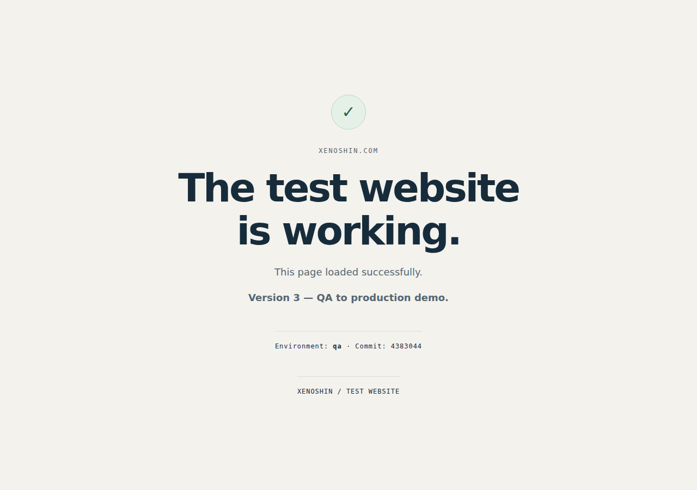
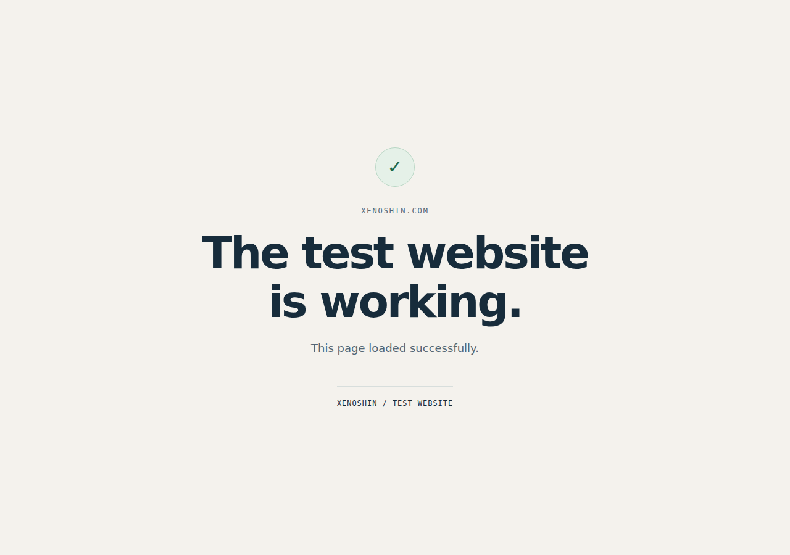
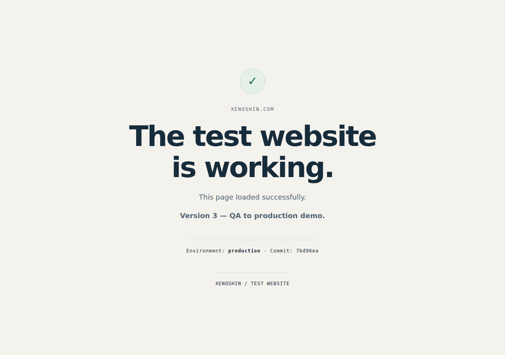

# Xenoshin — secure QA and production deployment

**[Production: xenoshin.com](https://xenoshin.com)** · **[QA: qa.xenoshin.com](https://qa.xenoshin.com)**

[Public GitHub repository](https://github.com/pb392/is373_ci_cd) · [Docker Hub images](https://hub.docker.com/r/pb392/is373_ci_cd)

A minimal containerized test website on my DigitalOcean Droplet. The homepage shows the release message, environment, and running commit; the original calculator remains at `/calculator`.

## Promotion rule

1. Push a change to `qa`. GitHub Actions runs unit, API integration, and Chromium browser tests on native AMD64 and ARM64 runners. It builds each platform once, tests that exact image, and publishes the saved artifacts to `pb392/is373_ci_cd:qa` only after all checks pass.
2. The server's WUD updater observes the QA image digest and replaces only the QA container. The workflow waits for `https://qa.xenoshin.com/health` to report the expected commit and `qa` environment. QA changes do not change production.
3. Review QA, then merge a pull request from `qa` into `main`. The same checks publish `:prod`; the updater replaces only production. The workflow verifies the expected production commit over HTTPS and captures both pages.

Pull requests and manual workflow runs test but never publish. A failed test or build prevents publication. Registry credentials use the GitHub Actions secret `DOCKER_API_REP`; no server private key is needed by Actions. Source changes are promoted by merge; each branch commit has its own tested immutable image tag.

## Test Evidence

Verified October 15, 2026. The demonstration below records actual releases and screenshots, not planned results.

| Stage | Successful workflow | Deployed commit | Observed result |
| --- | --- | --- | --- |
| Initial QA bootstrap | [QA setup](https://github.com/pb392/is373_ci_cd/actions/runs/38776465642) | `2bd73b041e2fd9d130a53f95b425291249590fad` | Version 2 on QA; initial container startup through non-root administration. |
| Automatic QA update | [QA Version 3](https://github.com/pb392/is373_ci_cd/actions/runs/38777135301) | `4383044fe2b57f708b7865be7710de64da643caa` | QA automatically changed to Version 3 while production stayed at `4127aa3f2514e95e738ed88a31bb2ca89b581d96`. |
| Promotion to production | [Production Version 3](https://github.com/pb392/is373_ci_cd/actions/runs/38777729613) | `7bd96ead44ff779d605df7e9da3501d16b09a827` | [PR #6](https://github.com/pb392/is373_ci_cd/pull/6) merged QA into main; production automatically changed to Version 3 while QA retained its own commit. |

Each release passed **38 unit tests, 18 integration tests, and 9 real-browser tests on each native AMD64 and ARM64 runner** before publication. The `verify` dependency blocks publication after a failed test/build. The final deployment job checks the expected live commit and environment over trusted HTTPS, then captures both pages.

**Image registry:** [pb392/is373_ci_cd](https://hub.docker.com/r/pb392/is373_ci_cd). Demonstrated immutable release tags:

- QA: `pb392/is373_ci_cd:sha-4383044fe2b57f708b7865be7710de64da643caa`; index digest `sha256:9251e01be564dc86a8cfffc38a74e70316d64d14a14c21a617eb0dbf6f0c8a82`.
- Production: `pb392/is373_ci_cd:sha-7bd96ead44ff779d605df7e9da3501d16b09a827`; index digest `sha256:66a654b545f9f2da73aebd77c1b7c7bb951930c91b1b19920262942e8a1a7c2f`.

[QA image/platform receipt](docs/assessment/qa-release.json) · [Production image/platform receipt](docs/assessment/production-release.json) · [QA isolation observations](docs/assessment/qa-isolation.json) · [After-promotion observations](docs/assessment/after-promotion.json).

The screenshots and commit IDs above document the promotion demonstration. Later documentation-only releases may advance the production commit without changing the page. Current running identities are always visible at [QA health](https://qa.xenoshin.com/health) and [production health](https://xenoshin.com/health), and the latest runs are on [GitHub Actions](https://github.com/pb392/is373_ci_cd/actions/workflows/ci.yml).

### Visible change: QA first, production afterward

QA started at [Version 2](docs/assessment/qa-version-2.png). The subsequent QA push visibly introduced Version 3:



At that same point, production still showed the original page:



After merging QA into main, production automatically showed Version 3 with its production environment and merge commit:



### SSH security evidence

[Redacted terminal verification](docs/assessment/ssh-verification.txt) records:

- Successful SSH-key login as the non-root `webadmin` account (UID 1000) and successful limited sudo administration.
- Effective `PermitRootLogin no`, `PasswordAuthentication no`, `KbdInteractiveAuthentication no`, and `PubkeyAuthentication yes`.
- Root key login rejected with exit status 255.
- Password-only login rejected with exit status 255.

The non-root login and administration command were verified before root SSH was disabled. QA's initial deployment also ran through `webadmin`; subsequent deployments were performed by the automatic updater. No private keys, passwords, or tokens are included in this evidence.

### Explain and demonstrate in class

Push a small visible change to `qa`; show the QA workflow, new QA page/commit, and unchanged production page/commit. Review QA and merge its PR into `main`; show the production workflow and updated production page. Explain that tests gate image publication, WUD watches separate tags, and the workflow independently verifies the deployed commit. For SSH, use `ssh webadmin@104.248.180.176` and `sudo /usr/local/sbin/xenoshin-admin ssh-settings`; demonstrate that direct root and password-only logins are rejected.

## Deployment configuration

- [Application services](compose.yaml): separate QA and production containers on loopback ports 8092 and 8090. The local development service uses 8080.
- [HTTPS proxy](deploy/traefik.compose.yaml) and [routing overlay](deploy/routes.yaml): only QA and production have public HTTPS routes. HTTP redirects to HTTPS and certificates renew automatically.
- [Public domain settings](deploy/site.env.example): copy to the server checkout as `.env`; copy the routing overlay as `compose.override.yaml`.
- [SSH policy](deploy/ssh-hardening.conf): install only after verifying non-root key access. Disables root and password/keyboard-interactive SSH.
- [Limited administration command](deploy/xenoshin-admin): installed root-owned and executable; `webadmin` may use sudo for only the enumerated operations. No unrestricted passwordless sudo was added.

The site runs on the owner's DigitalOcean server at `104.248.180.176`. Application checkout: `/opt/is373_ci_cd`; proxy: `/opt/xenoshin-hosting`. SSH administration uses `webadmin@104.248.180.176`. Private SSH keys, certificates, tokens, and updater passwords are never committed.

The QA and production services follow separate image channels and have no shared source-code mounts. The updater dashboard stays on loopback port 8091 with authentication; it is not publicly routed. Its Docker access is privileged. Pause/resume operations stop/start the common updater, affecting automatic updates for both environments; a production rollback recreates production only.

## Run and test locally

```sh
git clone https://github.com/pb392/is373_ci_cd.git
cd is373_ci_cd
make setup
make browsers
make test-unit
make test-integration
make build
make test-e2e
make dev
```

Development: http://localhost:8080. Calculator: http://localhost:8080/calculator.

For initial server bootstrap, configure the external `hosting-web` network/proxy and routing overlay, then use `make deploy` and `make deploy-qa` after the corresponding images exist. Subsequent branch releases update automatically. Docker starts on boot; the services use restart policies.

## Historical template documentation

This project builds on the course calculator template. Older records in `docs/evidence.md`, `docs/qa.md`, and `docs/integration-evidence.md` refer to the original author's demonstration and are not this student's submission evidence. Use this README's Test Evidence section for the Xenoshin deployment.

[Specification](docs/spec.md) · [Testing](docs/testing.md) · [CI/CD details](docs/ci-cd.md) · [Contributing](CONTRIBUTING.md)
